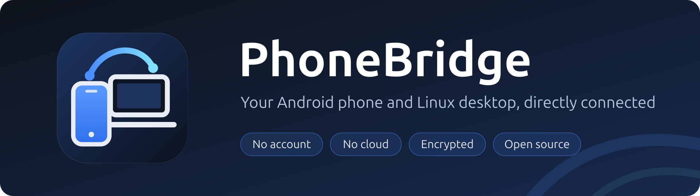

<p align="center">
  
</p>

# PhoneBridge

Securely connect and control your Android phone and Linux PC with wireless and USB connectivity. An account-free, cloud-free bridge between an **Android phone** and a **Linux desktop**: notifications, SMS/MMS, calls, photos, files, clipboard, screen mirroring with control, phone-as-webcam, and (opt-in) controlling the PC from the phone. Everything travels directly between your two devices, end-to-end encrypted.

> **Status: 1.4.0, pre-release.** Not yet published. Licensed under Apache-2.0. Verified on one phone (Xiaomi Mi A3, Android 17) and one PC (Ubuntu 24.04). Not available on Google Play (see `docs/PLAY_STORE.md`).

## Features and status
Labels: **Implemented** = built and covered by automated tests and/or the author's hardware runs; **Partial** = works but with known gaps; **Experimental** = may fail on some apps/devices; **Not tested** = code exists, not exercised on a device in this release. Details and file locations: [`docs/PROJECT_REPORT.md`](docs/PROJECT_REPORT.md).

| Feature | Status |
|---|---|
| QR / PIN pairing (SPAKE2), encrypted sessions, discovery, USB link | Implemented |
| Notifications (mirror, dismiss, reply) | Implemented |
| File transfer both ways (resume, SHA-256), photo browser | Implemented |
| Clipboard sync (text, images) | Implemented (phone to PC only while the app is focused: Android 10+ limit) |
| SMS read and send | Implemented |
| MMS | **Partial** - never sent through a real carrier |
| Calls (history, dial, answer, mute) | **Partial** - declining a call is best-effort on Android |
| Call audio on the PC (Bluetooth) | **Experimental** |
| Screen mirroring with mouse/keyboard control | Implemented (needs an unlocked phone and a consent tap each time) |
| Per-app streaming | **Experimental** |
| Screen sync / smart display-off | **Partial** - rotation sync not implemented; some hardware paths unverified |
| Phone camera as a webcam (v4l2loopback) | **Partial** - no automated test of the video sink |
| Self-hosted relay (use away from home) | **Partial** - tested on loopback only, not across the internet |
| Mount the phone's files on the PC (FUSE) | **Partial** |
| Join the phone's hotspot from the PC | **Partial** - a real access point was never exercised |
| Phone controls the PC (shell, files, screen, input) | Implemented - off by default, approval on the PC, one hour at most |
| Security dashboards, signed audit log, per-feature permissions | Implemented |
| Android main screen: landscape-only, both landscape directions (by design) | Implemented, seen on one phone. Portrait is **not supported**; split-screen behaviour is **not verified** |
| TalkBack support on Android | **Not tested** on a device |
| The shrunk (R8) release APK | **Partially tested** on one phone (Mi A3, Android 17, USB tunnel): it starts, pairs, mirrors, transfers a file and enforces the PC-control approval with no crash in those paths; most features were not exercised - see `docs/DEVICE_SMOKE_TEST.md` |
| iPhone app, screen-rotation sync, localisation | Not implemented |

## Screenshots
_Screenshots will be added here. They must be real captures of the running apps._

| PC: Device page | PC: Screen mirror | Android: Home | Android: Security |
|---|---|---|---|
| _placeholder_ `docs/screenshots/pc-device.png` | _placeholder_ `docs/screenshots/pc-mirror.png` | _placeholder_ `docs/screenshots/android-home.png` | _placeholder_ `docs/screenshots/android-security.png` |

## Quick start
```sh
./packaging/install.sh && phonebridge        # Linux app
# Android: install the APK from the release page (see docs/INSTALLATION.md), then pair via QR or PIN
```
Build from source: `docs/BUILD_GUIDE.md`. Run all tests: `tools/run_tests.sh`.

## Documentation
| | |
|---|---|
| `docs/INSTALLATION.md`, `docs/BUILD_GUIDE.md`, `docs/TROUBLESHOOTING.md` | using and building |
| `docs/ARCHITECTURE.md`, `protocol/PROTOCOL.md` | design and wire protocol |
| `docs/SECURITY.md`, `SECURITY.md` | security model / reporting a vulnerability |
| `docs/PROJECT_REPORT.md`, `docs/AUDIT_REPORT.md` | status and audit results |
| `docs/SIGNING.md`, `docs/RELEASE.md`, `docs/PLAY_STORE.md` | signing, releasing, Google Play |
| `CHANGELOG.md`, `RELEASE_NOTES.md`, `docs/DEVELOPMENT_HISTORY.md` | history |

## Security in one paragraph
TLS 1.3 with a pinned certificate, an Ed25519-signed ephemeral key exchange, AES-256-GCM, SPAKE2 PIN pairing, per-feature permissions on both devices, a signed hash-chained audit log. Phone-controls-PC is off by default, needs approval on the PC, shows a banner while active and ends after at most one hour. This has had automated tests, fuzzing and an AI-assisted review, **not** an independent human audit. Limits are listed in `docs/SECURITY.md`.

## Contributing / bugs
`CONTRIBUTING.md`. Report security problems privately through GitHub's "Report a vulnerability" (`SECURITY.md`), never in a public issue.

## License
Apache License 2.0 - see `LICENSE` and `NOTICE`. Copyright 2026 Saiprakash Manepalli.
