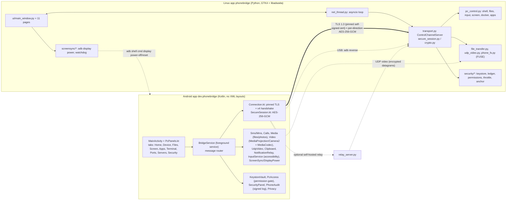
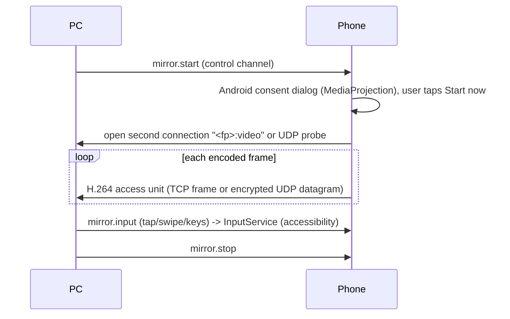
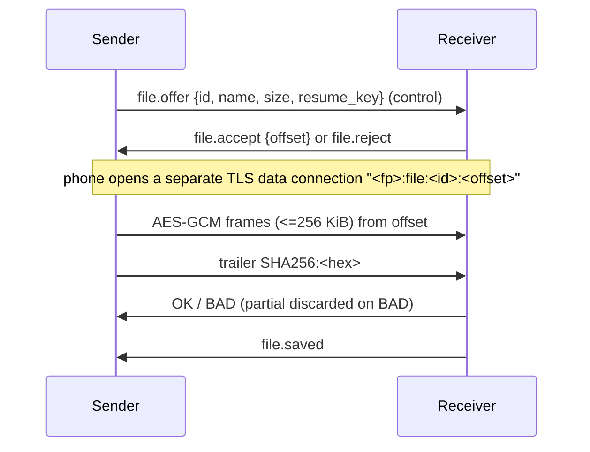

# Architecture

Everything below was checked against the source (file names in backticks). The wire protocol is specified in `protocol/PROTOCOL.md`.

## Components


## Ports and discovery (from `transport.py`, `relay_server.py`, `mdns.py`)
Control/TLS server `28100` (`DEFAULT_PORT`), UDP discovery `28101` (`DISCOVERY_PORT`), relay default `28200`, mDNS service `_phonebridge._tcp`. Also BLE wake and Bluetooth RFCOMM for pairing. The server drops sources that are not loopback/USB/private/link-local/attached networks (`peer_policy.py`; `PHONEBRIDGE_ALLOW_PUBLIC=1` disables).

## Connection and pairing
```mermaid
sequenceDiagram
  participant PC
  participant Phone
  PC->>PC: show QR (PC pubkey, cert fingerprint) + 6-digit PIN, 60 s, single use
  Phone->>PC: find PC (QR scan / Bluetooth / LAN broadcast / USB tunnel)
  Phone->>PC: SPAKE2 (P-256) messages; PIN never sent
  PC-->>Phone: key confirmation; both show a confirmation code
  Note over PC,Phone: user approves; Ed25519 identities and TLS cert pin are stored
  Phone->>PC: later: TLS 1.3 connect, pinned cert
  Phone->>PC: signed ephemeral X25519 handshake, key confirmation
  PC-->>Phone: per-direction AES-256-GCM keys, replay window, in-band rekey
```
3 wrong PINs burn the code (`pairing.py`, `spake2.py`, `Pairing.kt`, `Spake2.kt`).

## Screen mirroring

UDP video has loss-driven bitrate adaptation and keyframe requests; it falls back to TCP (`udp_video.py`, `UdpVideo.kt`, `Video.kt`).

## File transfer


## Remote control of the PC (phone controls the PC)
Messages `pc.*` / `pcfiles.*` are handled in `pc_control.py` only if the phone's "Allow PC control" is on **and not expired** (default 60 min, `PHONEBRIDGE_PC_CONTROL_MINUTES`). It provides: system info, ports, services/Docker start-stop, app launch, files under `$HOME` (no dot-paths), clipboard, mouse/keyboard and screen view via the RemoteDesktop portal (`pc_remote.py`), and a PTY shell (`terminal.py`, environment without `PHONEBRIDGE_*`).

## Storage
PC: `~/.config/phonebridge/` (device JSON files, `audit.jsonl`, certs, settings); secrets in the desktop keyring or a 0600 file store. Phone: app-private storage, Android-Keystore-wrapped keys. No database. Details: `docs/SECURITY.md`.
