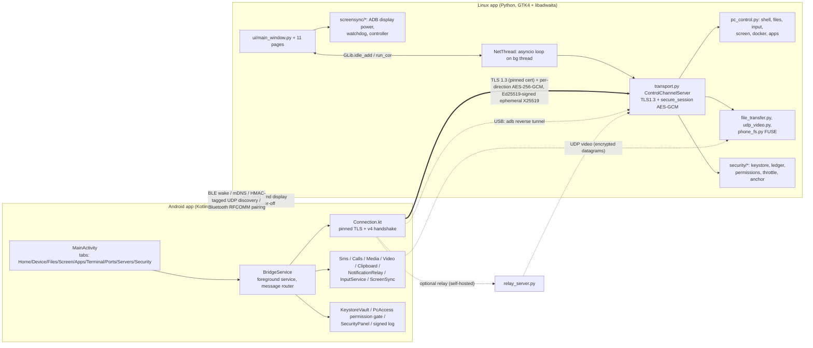

# PhoneBridge — Project Audit Report

> **Point-in-time report (2026-11-19, first audit).** Sections 1-22 describe the project *as audited*; several findings (no version control, debug-signed release, no license, stale docs) have since been fixed. See Appendices B and C and `docs/PROJECT_REPORT.md` / `docs/RELEASE_READINESS.md` for the current state.

| | |
|---|---|
| **Audit date** | 2026-11-19 |
| **Scope** | the app directory (this repository), plus a separate `PhoneBridge-Research/` folder (docs only, not in this repository) and two local backup tarballs (not in this repository) |
| **Method** | Static reading of source, config, docs and build files; a real run of the existing PC test-suite; targeted `grep` scans. No project file was modified (test run used a scratch `HOME`, no D-Bus, `PYTHONDONTWRITEBYTECODE=1`; the real `~/.config/phonebridge` was verified untouched afterwards). |
| **Not done** | No Gradle/Android build was run, no phone was connected, no GUI was visually inspected, no network/OSV dependency scan was run (that tool sends package names to an external service; not run without your approval). |
| **Conventions** | **Verified** = seen in code or produced by a command I ran. **Suspected** = inferred from code, not reproduced. **Docs claim** = stated in docs, not independently re-verified by me. |

---

## 1. Project Overview

| Item | Finding |
|---|---|
| Name | PhoneBridge (PC app id `dev.phonebridge.Linux`, Android package `dev.phonebridge`) |
| Purpose | A login-free, cloud-free "Phone Link for Linux": notifications, SMS/MMS, calls, photos, clipboard, file transfer, screen mirroring (+ PC-driven display-off "screen sync"), phone-as-webcam, app launching, and the reverse direction (phone controls PC: files, terminal, mouse/keyboard, screen, Docker/services). |
| Problem solved | Microsoft Phone Link / KDE Connect-style integration for Linux without a Microsoft/Google account. Trust is local-only (pairing records on each device). |
| Target users | Single technical user with one Android phone and one Linux desktop (GNOME/GTK4). Sideload-only — `build.gradle.kts` explicitly says "never published to Play". |
| Platforms | Linux desktop (Python 3.10+, GTK4/libadwaita); Android 8+ (`minSdk 26`, `targetSdk 29`, `compileSdk 35`). iPhone app was removed (`ios-removed-backup.tar.gz`), though the PC still accepts an `ios` hello. |
| Version | PC package `1.4.0` (`linux/pyproject.toml`), Android `versionName 1.4.0` / `versionCode 14`. README headline still says v1.3 (stale). |
| Stage | Late-stage personal/hobby product: feature-broad, security-heavy, partly hardware-verified on one device (Xiaomi Mi A3, LineageOS/Android 17). Not packaged for distribution (no .deb/Flatpak, no CI, no VCS). |
| Goals | Match Phone Link's feature set, add Linux-specific extras, with strong local security (PAKE pairing, forward secrecy, signed audit ledger). |

**Size (verified by `wc`):** PC Python ≈ 12.8k lines (`linux/phonebridge`), Android Kotlin ≈ 7.9k lines (32 files, none under `src/test`), PC tests ≈ 6.0k lines across 39 `test_*.py` files + 5 Kotlin JVM harnesses, protocol spec 499 lines + `schema.json`.

---

## 2. Project Architecture

### 2.1 Overall architecture
Two peer applications talk over one authenticated, encrypted **control connection** plus on-demand **data connections**. The PC is the TLS server; the phone is the client. There is no cloud; an optional self-hosted relay forwards opaque bytes.



### 2.2 Frontend architecture
* **PC (verified):** `Adw.Application` → `MainWindow` (`ui/main_window.py`, 843 lines) with an `Adw.NavigationSplitView`: sidebar `ListBox` of 11 sections (`SECTIONS`, lines 35-45) + `Gtk.Stack` of page widgets, one module per page in `ui/`. Single CSS file `ui/style.css` (165 lines, dark palette shared with the phone). A "loading" mixin (`ui/loading.py`) handles progress for list requests (`_LOAD_REQUESTS`).
* **Android (verified):** no XML layouts at all (`res/` has only drawables, mipmaps, one string, two xml). The whole UI is built programmatically (`MainActivity.buildShell`, `Ui.kt`, `PcPanels.kt` 1,236 lines). Left tab column + content area; **forced `sensorLandscape`** on the main activity (`AndroidManifest.xml`).

### 2.3 Backend / data flow
No server backend. The asyncio network layer runs on a daemon thread (`net_thread.py`); GTK calls it with `run_coro`, and it calls GTK through `GLib.idle_add`. Messages are JSON envelopes (`protocol.py`, `protocol/schema.json`) dispatched by type to handlers registered with `server.on(type, handler)`.

1. **Pairing:** QR or PIN → Bluetooth RFCOMM or Wi-Fi/USB route → SPAKE2 (P-256) PIN verification → Ed25519 identities exchanged → pairing key + TLS cert fingerprint stored.
2. **Connect:** discovery (mDNS / HMAC-tagged UDP broadcast / BLE wake / relay / USB tunnel) → pinned TLS 1.3 → signed ephemeral X25519 handshake → key confirmation → per-direction AES-256-GCM with replay window and in-band rekey.
3. **Use:** each message is checked against the PC-side per-phone permission and (for PC-control) `allow_pc_control`; on the phone, `PcAccess` gates what the PC may request.
4. **Bulk data:** one TLS data connection per file (sha256, resume), TCP or UDP-encrypted video.

---

## 3. Technology Stack

| Layer | Technology | Why / where |
|---|---|---|
| PC language | Python ≥3.10 (system 3.12 used here) | whole PC app, tests, tools |
| PC UI | GTK4 + libadwaita via PyGObject ≥3.46 | `ui/*`, `app.py` |
| PC crypto | `cryptography` ≥46 (declared) | TLS identity, Ed25519, X25519, AES-GCM, scrypt (`crypto.py`, `secure_session.py`, `security/keystore.py`) |
| PC PAKE | in-repo SPAKE2 over P-256 (`spake2.py`) | PIN pairing; custom EC arithmetic (see §10) |
| Imaging / QR | `pillow` ≥13, `qrcode` ≥7.4 | pairing QR (`qr.py`), photo thumbnails |
| FUSE | `fusepy` (optional; **only in requirements.txt, not pyproject**) | `phone_fs.py` mount |
| Video | GStreamer (system) – appsrc → h264parse → avdec_h264 → v4l2loopback for webcam | `ui/video_view.py`, `ui/webcam_page.py`, `packaging/setup-webcam.sh` |
| Linux integration | D-Bus (RemoteDesktop portal, NetworkManager, Secret Service), `nmcli`, `ss`, `ip`, `docker`, `systemctl`, `adb`, BlueZ | `pc_remote.py`, `wifi_join.py`, `pc_info.py`, `screensync/adb_bridge.py`, `bluetooth_transport.py` |
| Android language | Kotlin 2.0.21, JVM 17 | all of `android/` |
| Android build | Gradle 8.14.7 (wrapper dist in `~/.gradle`; **no `gradlew` in repo**), AGP 8.11.1 | `android/*.kts` |
| Android libs | BouncyCastle `bcprov-jdk18on:1.87` (SPAKE2/Ed25519), `zxing-android-embedded:4.3.0` (QR scan), `androidx.core:1.13.1` | `build.gradle.kts` dependencies |
| Android platform APIs | MediaProjection + MediaCodec, Camera2, AccessibilityService, NotificationListenerService, Android Keystore, Telephony/SMS, BluetoothLE | per-feature Kotlin files |
| Packaging | `pyproject.toml` (setuptools), `packaging/install.sh` (user venv + desktop entry), `tools/sign_release.py` (Ed25519 manifest), `tools/publish_release.py` | |
| Test tooling | plain Python scripts (no pytest), `tests/run_all.py`, Kotlin harnesses compiled with Gradle's bundled kotlinc | |
| Storage | JSON files + signed JSONL ledger under `~/.config/phonebridge`, desktop keyring via libsecret (fallback file) | see §8 |

---

## 4. Complete Feature Inventory

Status judgement combines code inspection with the tests/hardware evidence available. "HW" = documented as exercised on the Mi A3 (docs claim; the repo contains the harness `linux/tools/hw_screensync_check.py` but I did not run it).

| Feature | Description | Status | Implementation location | Notes |
|---|---|---|---|---|
| QR / PIN pairing (SPAKE2 v4) | PAKE-verified PIN, confirmation code, 60 s single-use code, 3-strike | Fully implemented | `pairing.py`, `spake2.py`, `wifi_pairing.py`, `bluetooth_transport.py`; `Pairing.kt`, `Spake2.kt` | 33 + 18 tests pass; HW per `docs/SECURITY.md`. Custom EC code, never independently audited |
| Secure session (TLS1.3 + AES-GCM, rekey, rotation) | Forward secrecy, replay window, key confirmation | Fully implemented | `secure_session.py`, `transport.py`, `crypto.py`; `SecureSession.kt`, `Connection.kt` | 66 tests pass; cross-checked against Kotlin by skipped-here interop harness |
| Discovery (mDNS, UDP tag, BLE wake) | Find PC on LAN/hotspot | Fully implemented | `mdns.py`, `ble_wake.py`, `netutil.py`; `Mdns.kt`, `BleWake.kt`, `Net.kt` | 5 discovery tests pass; BLE not hardware-confirmed in docs I read |
| USB link (adb reverse) | Phone connects through USB tunnel | Fully implemented | `usb_link.py` | 12 tests pass; HW per docs |
| Self-hosted relay | Away-from-home forwarding | Partially implemented | `relay_server.py`, `relay_client.py` | 15 tests pass (fake phone). No evidence of a real WAN run; operator must expose a host |
| Notifications mirror/dismiss/reply | Phone→PC | Fully implemented | `ui/notifications_page.py`; `NotificationRelay.kt` | Privacy filters (hide text, sensitive auto-hide) per code; HW per docs |
| SMS read/send, threads | Two-pane messages | Fully implemented | `ui/messages_page.py`; `Sms.kt` | Not default-SMS app; sends ask each time |
| MMS view / send | Attach pictures, PDU build | Partially implemented | `Mms.kt`, `MmsPdu.kt`; `ui/messages_page.py` | Encoder tested only vs. a spec-based decoder (test skipped here); never sent through a real carrier (RELEASE_NOTES); sent MMS don't appear in phone's own app |
| Calls (history, dial, answer, mute, decline) | + contacts | Partially implemented | `ui/calls_page.py`; `Calls.kt` | Decline is best-effort per Android restrictions |
| Call audio on PC (Bluetooth HFP) | PC mic/speaker | Experimental | `call_audio.py` | Only unit/loopback tested per RELEASE_NOTES |
| Photos browse + auto-push | Paged grid, new-photo push | Fully implemented | `ui/photos_page.py`; `Media.kt` | |
| File transfer both ways | sha256, resume, cancel, traversal checks | Fully implemented | `file_transfer.py`, `ui/files_page.py`; `Media.kt` | 34 + 6 UI tests pass; HW 3 MB push/pull per docs |
| Mount phone as folder (FUSE) | | Partially implemented | `phone_fs.py` | Test skipped here (fusepy missing); optional dep not in pyproject |
| Clipboard sync (text + image, history) | Both directions, expiry, password-manager exclusion | Fully implemented | `clipboard_watcher.py`, `ui/clipboard_page.py`; `Clipboard.kt` | Phone→PC needs app in foreground (Android 10+ limit, documented) |
| Screen mirroring + control | MediaProjection H.264, mouse/keyboard | Fully implemented | `ui/mirror_page.py`, `ui/video_view.py`, `udp_video.py`; `Video.kt`, `InputService.kt` | Needs unlocked phone + consent tap each time. HW: USB/TCP and UDP (173 frames/8 s) per docs |
| UDP video | Encrypted datagrams, loss-driven bitrate/keyframes | Fully implemented | `udp_video.py`; `UdpVideo.kt` | 31 tests; no retransmission/FEC by design |
| Per-app streaming | One app on virtual display | Experimental | `ui/apps_page.py`; `Video.kt` | Documented as experimental; many apps blank/refuse |
| Screen sync / smart display-off | PC powers phone panel off via adb, probe-based liveness, watchdog | Partially implemented | `screensync/*`, `ui/sync_page.py`; `SyncCore.kt`, `ScreenSync.kt`, `DisplayPower.kt`, `MirrorPanel.kt` | 132 + 21 tests pass. **Not implemented:** rotation sync. **Not HW-verified (my notes):** phone-side crash watchdog, dim-overlay fallback, phone-initiated flow through display-off. Scroll while panel off: flaky (2 HW runs disagreed). Custom-drawn UIs need screen on |
| Phone as webcam | Camera2 → v4l2loopback | Partially implemented | `ui/webcam_page.py`, `packaging/setup-webcam.sh`; `Video.kt` | Needs v4l2loopback modprobe; no automated test for the v4l2 sink |
| Apps launcher | List/launch phone apps | Fully implemented | `ui/apps_page.py` | |
| Device info / hotspot / Wi-Fi join | Battery, signal, storage, hotspot, join via NM D-Bus | Partially implemented | `ui/device_page.py`, `wifi_join.py`; `DeviceInfo.kt`, `Hotspot.kt` | Join of a real AP never exercised (docs) |
| Phone→PC control: terminal | PTY login shell for the phone | Fully implemented (dangerous by design) | `terminal.py`, `pc_control.py`; `PcPanels.kt` | Off by default; gated by `allow_pc_control` |
| Phone→PC control: files, ports, servers, Docker, apps, input, screen view | | Fully implemented | `pc_control.py`, `pc_info.py`, `pc_remote.py` | 12 tests pass |
| Security dashboards | Identities, ledger verify, permissions, privacy, revoke, DISCONNECT ALL | Fully implemented | `ui/security_page.py`, `security/*`; `SecurityPanel.kt`, `PhoneAudit.kt`, `PcAccess.kt` | 69 + 12 + 18 tests |
| Signed hash-chained ledger + optional anchor | Tamper-evident audit | Fully implemented | `security/ledger.py`, `anchor.py`, `anchor_server.py` | Anchoring off by default |
| Signed update verification | Verify-only, no auto-install | Partially implemented | `updates.py`, `tools/sign_release.py`, `tools/publish_release.py` | No update server; Android APK is debug-signed (see ISSUE-02) |
| Linux packaging | user-level install script | Partially implemented | `packaging/install.sh`, `uninstall.sh` | No .deb/Flatpak/AppImage; `install.sh` installs `pip --upgrade pip` unpinned |
| iPhone support | | Not implemented | residual `platform: ios` handling in PC; `test_ios_*.py` | App removed; PC keeps dead-ish compatibility code (5 references) |
| Screen-rotation sync | | Not implemented | — | Stated in my notes and docs |
| Multi-phone | Dropdown to choose which phone tabs control | Partially implemented | `ui/main_window.py` `_phone_dropdown` | `test_single_phone.py` passes; docs lean "one phone" |
| Localization | | Not implemented | — | Hard-coded English strings (Android `strings.xml` holds one string) |

---

## 5. UI/UX Analysis

### 5.1 Screens
**PC (11 sections, verified in `SECTIONS`):** Device, Notifications, Messages, Calls, Photos, Files, Screen mirror, Mirror dashboard (sync), Camera, Apps, Security; plus Pairing window (`ui/pairing_window.py`), the clipboard panel (`clipboard_page.py`, reachable but not in `SECTIONS`; **suspected** to be embedded elsewhere — I did not trace it) and a status card with a phone selector.
**Android (9 tabs):** Home, Device, Files, Screen, Apps, Terminal, Ports, Servers, Security (`MainActivity.kt:502-504`), plus transparent helper activities (screen-capture consent, unlock, clipboard send) and the QR scanner.

### 5.2 Findings
| Area | Observation | Evidence |
|---|---|---|
| Navigation | PC: standard libadwaita sidebar → stack; adaptive via `NavigationSplitView`. Android: vertical tab column, 1/4 width. | `main_window.py:150-200`, `MainActivity.kt:119-166` |
| Design consistency | Good: one shared dark palette in `style.css` and `Ui.kt`. Android uses `Theme.Material.NoActionBar` (old Material) with hand-drawn widgets. | `style.css:1`, `Ui.kt` |
| Loading states | Present on PC for list pages via progress mixin (`loading.py`). Android: not systematically verified. | `ui/loading.py`, `_LOAD_REQUESTS` |
| Empty/error states | PC uses `Adw.StatusPage`/"empty" in ~16 places across pages; error toasts via `MainWindow.toast`. Coverage per page unverified visually. | grep count |
| Accessibility | **Weak.** PC: 4 `accessible` references and 44 tooltips across `ui/`; no keyboard-navigation audit. Android: only **3** `contentDescription` in all Kotlin; custom-drawn widgets, no TalkBack support evident. | grep |
| Responsiveness | PC: split view collapses. Android: **main activity locked to `sensorLandscape`** — a phone UI that can't be used in portrait; large forms (e.g. Terminal on-screen keyboard) are a custom `InAppKeyboard.kt`. | Manifest, `InAppKeyboard.kt` |
| Theming | Dark only (`style.css` header says dark theme); no light/high-contrast option; **unverified** how it follows system theme. | |
| Visual verification | The README's phase notes say the GTK app was "not yet visually run"; later notes/tests (9 UI tests, mostly passing under xvfb) show it is exercised headlessly. I did not screenshot it. | `README.md`, `tests/*_ui.py` |
| UX problems | (1) Consent prompt per screen-share is an Android requirement but the flow needs a person at the phone; (2) several simultaneous permission "Ask" notifications on connect; with notifications disabled the ask times out as deny (docs); (3) Settings requiring manual steps: Accessibility, Notification access, overlay, battery optimisation, v4l2loopback. | `docs/SECURITY.md` limits |

---

## 6. Codebase Structure

```
PhoneBridge-linux-src/
├── README.md, RELEASE_NOTES.md           docs (partly stale — see ISSUE-03/04)
├── docs/{SECURITY,SCREEN_SYNC}.md
├── protocol/{PROTOCOL.md,schema.json}    wire spec (499 lines) + JSON schema
├── linux/                                PC app
│   ├── pyproject.toml, requirements.txt
│   ├── data/                             .desktop + SVG icon
│   ├── phonebridge/
│   │   ├── app.py                        ENTRY POINT (phonebridge.app:main)
│   │   ├── net_thread.py                 asyncio loop on a thread
│   │   ├── transport.py (719)            ControlChannelServer / DeviceConnection – core
│   │   ├── secure_session.py, crypto.py, spake2.py, tls_identity.py
│   │   ├── pairing.py, wifi_pairing.py, bluetooth_transport.py, qr.py
│   │   ├── file_transfer.py, udp_video.py, phone_fs.py
│   │   ├── pc_control.py, pc_info.py, pc_remote.py, terminal.py   phone→PC control
│   │   ├── relay_server.py, relay_client.py, usb_link.py, mdns.py, ble_wake.py, netutil.py, peer_policy.py
│   │   ├── clipboard_watcher.py, privacy.py, call_audio.py, updates.py, wifi_join.py
│   │   ├── security/   keystore, ledger, permissions, throttle, anchor(+server)
│   │   ├── screensync/ controller(582), display_power, display_watchdog, adb_bridge, commands, states, settings, glue, launch_sync
│   │   └── ui/         main_window(843) + 11 pages, loading.py, video_view.py, style.css, icons/
│   ├── tests/          39 test_*.py, run_all.py, fuzz_protocol.py, _isolate.py, _phone.py, Kotlin harnesses (sync/ mms/ v4/ spake/)
│   └── tools/          phone_smoke.py, hw_screensync_check.py (hardware harness)
├── android/            Gradle project (no gradlew, no app/src/test)
│   └── app/src/main/java/dev/phonebridge/*.kt   32 files; BridgeService (702) and PcPanels (1,236) are the biggest
├── packaging/          install.sh, uninstall.sh, setup-webcam.sh
└── tools/              sign_release.py, publish_release.py, audit_dependencies.py, bench.py
```
Outside the repository (in its parent folder): `PhoneBridge-Research/` (9 markdown analyses of Windows Phone Link and the design — no code), `ios-removed-backup.tar.gz`, `phonebridge-src-backup-20261117-2232.tar.gz`.

**Clutter that should not be in the tree (verified):** `linux/phonebridge.egg-info/`, `__pycache__/` dirs, `android/build/`, `android/.gradle/`, `android/.kotlin/`, `android/local.properties` (absolute SDK path; git-ignored by `.gitignore`, but there is no git).

**Largest / most complex modules:** `main_window.py` 843, `transport.py` 719, `BridgeService.kt` 702, `screensync/controller.py` 582, `PcPanels.kt` 1,236.

---

## 7. Backend and Business Logic

There is no remote backend. The "backend" is the PC's asyncio `ControlChannelServer` and handler modules.

| Concern | Implementation |
|---|---|
| Services / endpoints | Message types in `PROTOCOL.md` §4-4g, routed via `server.on("type", handler)`. `pc_control.py:46-62` registers 16 `pc.*`/`pcfiles.*` handlers; other modules register their own. |
| Authentication | First-frame authenticated connection: TLS 1.3 + signed ephemeral handshake bound to the PC cert; throttle with back-off (`security/throttle.py`); key confirmation prevents replayed hello displacing a live session. |
| Authorization | Per-phone, per-feature allow/deny/ask on PC (`security/permissions.py`). PC-control messages additionally need `PairedDevice.allow_pc_control` (re-read from disk **on every message**, `pc_control.py:67-69`). Phone side: `PcAccess.kt` permission manager, send-SMS/place-call ask every time. |
| Network policy | Server listens on all interfaces but drops non-private/non-loopback/non-attached sources before protocol parse (`peer_policy.py`); `PHONEBRIDGE_ALLOW_PUBLIC=1` disables. |
| Validation | Fingerprints hex-validated; docker ids regex-validated (`pc_info.py:docker_action`); file paths resolved and checked to stay under `$HOME` with no dot-components (`pc_info.py:_inside_home_visible`); first-line length caps and deadlines. Parser fuzzing exists (`test_fuzz_quick.py`, `fuzz_protocol.py`). |
| Background tasks | NetThread loop, clipboard watcher (XWayland helper), display watchdog (detached process), phone wakelock only during transfers (30 s ping), ledger append, transfer cleanup (7-day partial purge). |
| Error handling | Broad `except Exception` in `transport.py` (7), `file_transfer.py` (7), etc., with 46 `# noqa: BLE001` marking intent; failures mostly reported to the peer as `pc.status`/`error` messages. |
| Terminal | Full login shell via `pty.fork` with `TERM=dumb`; `env = dict(os.environ, …)` — passes the app's entire environment to the shell (`terminal.py:36-38`). |
| Business rule highlights | Single-use 60 s pairing codes; screen-sync liveness by content probe not frame silence; display-off is PC-driven via adb and restored by a detached watchdog. |

---

## 8. Database and Data Storage

No database. All state is file-based.

| Data | Location | Protection | Notes |
|---|---|---|---|
| Pairing records (`devices/<fp>.json`) | `~/.config/phonebridge/devices/` | atomic writes + locked updates (post-incident); session keys wrapped by keystore | Records re-read per message for the PC-control gate |
| Private keys (identity, TLS, pairing keys) | Secret Service keyring; fallback 0600 file, encrypted only if `PHONEBRIDGE_PASSPHRASE` set | Dashboard reports "not protected" honestly | In the fallback case a passphrase in an env var is inherited by the PC-control shell (ISSUE-11) |
| TLS cert | `server_cert.pem` (public) | n/a | Key file is written 0600 to disk transiently for OpenSSL (`tls_identity.py:88`) |
| Audit ledger | `audit.jsonl` (72 KB observed) | Ed25519 signed, hash-chained; optional external anchor | Full-log replacement only detected with anchoring on |
| Settings | `screensync.json`, `remote_desktop_token`, `release_key.pub` | 0600 | |
| Received files | `~/Downloads/PhoneBridge`, `~/Pictures/PhoneBridge`; phone: app-private partials then MediaStore | partials 0600 / app-private | 7-day stale partial purge |
| Phone side | App-private storage, Android-Keystore-wrapped keys, signed log; `allowBackup=false` | | |
| Cache / SMS | SMS not written to PC disk (docs); thumbnails fetched on demand | | |

**Lifecycle / backup / deletion:** Revoke + "DISCONNECT ALL" exist. There is **no backup or export of pairing identity** — losing `~/.config/phonebridge` (or the keyring entry) means re-pairing; the docs' own incident note records a real instance (tests overwrote the keyring TLS key; re-pairing was needed).
**Data-loss/corruption risks:** (a) the project itself has no version control — see ISSUE-01; (b) ledger is append-only text, a crash mid-write could leave a truncated last line (**suspected**, not tested); (c) the release signing key lives at `~/.config/phonebridge-release/release.key` (0600) next to the data it should be offline from (verified present).

---

## 9. API and Integrations

| Integration | Purpose | Location | Flow | Auth | Failure handling | Active? |
|---|---|---|---|---|---|---|
| PhoneBridge control protocol (TLS 1.3 + AES-GCM) | Everything | `transport.py`, `Connection.kt` | JSON envelopes, request/response + push | Signed handshake + pinned cert | Reconnect with fresh keys; throttle; idle timeouts | Yes |
| Bluetooth RFCOMM | Pairing | `bluetooth_transport.py` | PC offers, phone replies, SPAKE2 | PIN (PAKE) | Timeout / retry via window | Yes |
| mDNS / UDP tagged broadcast / BLE wake | Discovery | `mdns.py`, `netutil.py`, `ble_wake.py` | | HMAC tag from pairing key | Falls back among methods | Yes |
| ADB (`adb reverse`, `adb shell cmd display power-off/power-reset`) | USB link, screen sync | `usb_link.py`, `screensync/adb_bridge.py`, `display_power.py` | PC → phone shell | USB-debug RSA auth (outside the app) | Watchdog restores panel | Yes (optional) |
| xdg-desktop-portal RemoteDesktop | PC remote input/screen | `pc_remote.py` | D-Bus portal session | Portal consent (token cached in `remote_desktop_token`) | Re-ask logic `_needs_reask` | Yes |
| NetworkManager D-Bus / `nmcli` | Hotspot join, Wi-Fi info | `wifi_join.py`, `pc_info.py` | Profile via D-Bus, no password in argv | Local | Timeouts, `OSError` caught | Yes |
| Secret Service (libsecret) | Key storage | `security/keystore.py` | | Keyring unlock | Falls back to file store | Yes |
| Docker CLI / systemctl / ss / ip | Servers & ports tabs | `pc_info.py` | `subprocess.run` with list args, timeouts | Local user | Caught, returns empty | Yes (gated by PC-control) |
| Relay (self-hosted) | Remote access | `relay_server.py`, `relay_client.py` | `PBRELAY pc|phone <room>` then bytes | Room id derived from pairing key; E2E TLS | Parked slots, caps (8/room, 10k rooms) | Optional, off by default |
| Private-chain anchor server | Ledger anchoring | `security/anchor_server.py` | | Signed heads | Optional | Off by default |
| OSV.dev | Dependency audit | `tools/audit_dependencies.py` | Manual run; sends package names/versions | none | | Dev tool only (not run by me) |
| Update manifest host | Update verification | `updates.py` | https/file URL fetch | Ed25519 pinned key | Refuse if no key / downgrade | Only by manual command |

No third-party SaaS, analytics, or API keys were found.

---

## 10. Security Audit (preliminary)

**Secrets scan:** a regex scan for hard-coded key/password/token string literals in `*.py`, `*.kt`, `*.kts`, `*.sh` (excluding tests) found **nothing**. The only secret-like artifacts are runtime-generated: `~/.config/phonebridge/*`, `~/.config/phonebridge-release/release.key` (0600, outside the repo; not read by me), and the debug keystore used for release signing.

### Strengths (verified in code)
* TLS 1.3 only on the server (`transport.py:427-430`), pinned self-signed cert on the phone (`PinningTrustManager`, `Connection.kt:273`).
* Fixed list of subprocess calls uses argument lists (no `shell=True`, `eval`, `exec`, `os.system`, or `pickle.load` anywhere in `linux/phonebridge`, verified by grep).
* Path handling for PC files blocks dot-directories and symlink escapes (`pc_info.py:213-257`).
* Docker action arguments are regex-checked and whitelisted.
* Network source filtering; throttling; fuzz tests exist.
* `allowBackup=false`; keys wrapped by Android Keystore.

### Findings

| ID | Sev | Finding | Status |
|---|---|---|---|
| S-1 | **High** | **Release APK is signed with the debug key** (`app/build.gradle.kts:25`), while README claims a dedicated `android/keystore/phonebridge-release.jks`; that directory does not exist. The Android same-signature rule is the only protection for the phone-side update path, and the Android debug key is a well-known, auto-generated key. Also `isMinifyEnabled=false`. | Verified |
| S-2 | **High (by design)** | The phone can get a **full interactive shell, file read, Docker control, and mouse/keyboard on the PC** once "Allow PC control" is on. The only barrier is one boolean read from a JSON file and the pairing trust. A compromised/stolen paired phone = remote code execution as the user. Off by default, which is the right default; there is no second factor, time limit, or per-session approval on the PC. | Verified |
| S-3 | Medium | The phone ships a powerful permission set (SMS read/send, call log, contacts, `CALL_PHONE`, accessibility remote control, notification listener, `SYSTEM_ALERT_WINDOW`, `ACCESS_FINE_LOCATION`, camera, mic via HFP). `targetSdk=29` deliberately opts out of scoped storage, runtime-permission hardening introduced later, and Android 11+ package-visibility. Documented as intentional; still raises exposure. | Verified |
| S-4 | Medium | Custom cryptography surface: SPAKE2 over P-256 implemented in Python (`spake2.py`) with a self-described "blinded Montgomery ladder, not constant-time at instruction level" and a Kotlin port. No third-party cryptographic review (docs admit a single fresh-context AI review only). | Docs + code read |
| S-5 | Medium | `cryptography` and Pillow on the **system interpreter** are 41.0.7 and 10.2.0, below the app's own declared minimums (≥46 / ≥13, which the project says are needed for security fixes). Tests were run against these old versions here. If `install.sh` is used, its venv is `--system-site-packages` and `pip install` would only upgrade if the declared floor forces it (it does here); the status of the actual installed venv was not inspected. | Verified versions; install state unknown |
| S-6 | Low | `terminal.py` launches the shell with `dict(os.environ, …)`, so `PHONEBRIDGE_PASSPHRASE` (fallback keystore encryption) and other env secrets are visible to anything the phone runs. | Verified |
| S-7 | Low | `server_cert` key is exported to a 0600 file for OpenSSL (`tls_identity.py:88-103`); any same-user process can read it anyway. | Verified |
| S-8 | Low | `device.info_request` and `relay.config` skip the phone permission gate (acknowledged in `docs/SECURITY.md` §11). | Docs + not re-checked in code |
| S-9 | Low | Peer policy accepts **any private/link-local/attached network** source, i.e. any host on a shared LAN can reach the handshake port (then must pass TLS pinning/handshake). Rate-limited, but a coffee-shop LAN is "private". | Verified in docs/code structure |
| S-10 | Low | `ACCESS_FINE_LOCATION` + `NEARBY_WIFI_DEVICES` requested only to show an SSID; privacy-sensitive for a marginal feature. | Verified |
| S-11 | Info | Dependency CVE status for the Android libs and an actual OSV scan were **not run by me**; the docs report "no known vulnerabilities" as of 2026-11-13. `zxing-android-embedded 4.3.0` (2021) and `androidx.core 1.13.1` are old. | Unverified |
| S-12 | Info | Release-signing private key sits on the same machine/user as the app data (`~/.config/phonebridge-release/release.key`); docs themselves say to move it offline. | Verified present |

Injection: none found in subprocess/FUSE/path code. XSS/SQL not applicable. Logging hygiene has a test (`test_log_hygiene`, 3 pass).

---

## 11. Performance Analysis

| Area | Observation | Status |
|---|---|---|
| Startup | `app.py` starts the net thread, binds the server, security engine, builds all 11 pages and immediately triggers `user_opened_viewer` (starts mirroring) on every launch. Blocking `run_coro(...).result(timeout=10)` on the GTK thread during activation. | Verified in code; not timed |
| Per-message disk I/O | `_gated()` does `PairedDevice.load()` (JSON file read) per PC-control message — including high-rate `pc.input` mouse moves — on the asyncio loop thread. | Verified code; impact **suspected** |
| Video | H.264 ≤1280 px, encrypted UDP, loss-driven bitrate; decode via GStreamer software `avdec_h264`. Docs report 173 frames/8 s at 1280×576 over Wi-Fi (HW). | Docs claim |
| Crypto cost | Bench in docs: handshake 1.4 ms, GCM 250 MB/s, 64 MiB transfer 63 MB/s on loopback. Plausible; not re-run. | Docs claim |
| Memory | Terminal scrollback capped at 64 KiB; thumbnails fetched on demand; ledger verification caches signatures. Photo grid and Python-side screen JPEG streaming (`ScreenStreamer`) are unbounded-ish; **unmeasured**. | Suspected |
| Python-side SPAKE2 | Pure-Python EC math for a one-shot 3-attempt exchange; fine. | Verified |
| Android | Foreground service + wakelock only during transfers; BLE wake and mDNS keep the app discoverable; `BridgeService` 702 lines handles routing on the main handler (`post`) — **suspected** jank risk during large listings. | Suspected |
| Scalability | Designed for 1 PC ↔ few phones. Relay caps rooms at 10,000 and 8 slots per room. | Verified |

---

## 12. Error Handling and Reliability

* **Broad catch-and-continue style:** 44 `catch (e: Exception/Throwable)` in Kotlin; ~25 `except Exception` in Python plus 46 `noqa: BLE001`. Prevents crashes but can hide faults; most paths surface a `pc.status` message.
* **Reconnect:** fresh keys on every reconnect; USB, LAN, relay fall-backs; UDP→TCP fallback; BLE wake.
* **Recovery:** detached display watchdog restores the phone panel if the PC app dies (HW: 1.4 s after `kill -9`); partial-transfer purge; TLS identity regenerated if key/cert mismatch.
* **Known failure points (documented or code-visible):** phone locked → consent prompt cancelled; notifications disabled → permission "ask" times out as deny; Android 8-9 refused (TLS 1.3); consent wake-lock capped at 60 s; adb missing → USB route and screen-sync disabled; no Secret Service → file fallback.
* **Offline:** fully LAN/USB; no cloud dependency; relay is the only optional intermediary.
* **Gaps:** no crash reporting; no persisted retry queue for undelivered messages (**suspected**); no timeout verification on every handler (unreviewed).

---

## 13. Testing Report

### 13.1 Commands executed
```
cd PhoneBridge-linux-src/linux
env -u DBUS_SESSION_BUS_ADDRESS HOME=<scratch> XDG_*=<scratch> PYTHONDONTWRITEBYTECODE=1 python3 tests/run_all.py
# afterwards, individually, to get reasons:
xvfb-run -a python3 tests/test_ios_tabs_ui.py   (and test_pairing_window_ui, test_screensync_ui)
python3 tests/test_android_audit.py | test_android_sync.py | test_mms_pdu.py | test_phone_fs.py
```

### 13.2 Results (real, this session; system Python 3.12, cryptography 41.0.7, Pillow 10.2.0, no `qrcode`, no `fusepy`)

**Total: 652 checks passed, 3 files failed, 5 files skipped, 31 files fully OK** (39 files run).

| Group | Result |
|---|---|
| Protocol / security / transport | anchor 18, audit_fixes 31, file_transfer 34, hardening 26, pairing_handshake 33, peer_policy 23, relay 15, secure_session 66, security 69, spake2 18, transport 6, udp_video 31, updates 21, usb_link 6, usb_pairing 6, video_connection 5, wifi_join 16, discovery 5, fuzz_quick 4, log_hygiene 3, pc_control 12, screensync 132, display_watchdog 21, ios_platform 5, single_phone 4 — all pass |
| UI (xvfb) that passed | app_stream_ui 4, clipboard_privacy_ui 8, device_link_ui 11, files_cancel_ui 6, messages_mms_ui 1, security_ui 12 |
| **FAILED** | `test_ios_tabs_ui`, `test_pairing_window_ui`, `test_screensync_ui` — **all three: `ModuleNotFoundError: No module named 'qrcode'`** when importing `phonebridge/qr.py:7`. This is an environment gap (a declared dependency not installed on this system Python), not a logic failure, but I did **not** see these tests pass. |
| **SKIPPED** | `test_android_audit`, `test_android_sync`, `test_mms_pdu` (need Java + Gradle's Kotlin compiler under `~/.gradle`; skipped because I deliberately redirected `HOME`, so this is partly my isolation — I did not re-run them with the real HOME), `test_phone_fs` (no `fusepy`), and `test_android_interop` (same Kotlin prerequisite). |

So **the Kotlin ↔ Python interop evidence (SPAKE2, audit log, sync, MMS) was not re-verified by me**; the claimed 553/0 in `docs/SECURITY.md` is stale (39 files / 652 now).

### 13.3 Coverage
* No coverage tool is configured; coverage is **not measurable** from what exists.
* Test style: custom scripts printing "N passed, M failed" parsed by regex in `run_all.py`; no pytest, no fixtures, no CI, no `tox`/`nox`.
* **Android:** no `app/src/test` or `androidTest`; Kotlin is tested only through five JVM harnesses that compile selected files outside Gradle, and a hardware script.
* **Untested / lightly tested critical paths:** `BridgeService` routing, `PcPanels` UI (1,236 lines), `InputService` accessibility gestures (HW-only), `Video.kt` capture, `ble_wake.py`, `call_audio.py`, `clipboard_watcher.py`, `webcam_page` GStreamer/v4l2 pipeline, real-AP Wi-Fi join, real WAN relay, real MMS delivery, FUSE mount in CI.
* The hardware harness (`tools/hw_screensync_check.py`) needs a human to tap a prompt; not runnable in automation.

---

## 14. Dependencies Audit

| Dependency | Declared | Where | Finding |
|---|---|---|---|
| cryptography | `>=46` | pyproject + requirements | System has 41.0.7 → below floor (S-5). No upper bound/lock. |
| pillow | `>=13.0.0` | both | System has 10.2.0 → below floor. |
| qrcode | `>=7.4` | both | **Missing on this system**, breaks 3 UI tests. |
| PyGObject | `>=3.46` | both | System 3.48.2 ✓ |
| fusepy | none | `requirements.txt` only | Optional; absent from pyproject so `pip install .` never gets it; no `extras_require`. |
| BouncyCastle 1.87 | pinned | Android | Pinned exactly (good). Docs: bumped for 5 advisories. |
| zxing-android-embedded 4.3.0 | pinned | Android | 2021 release, unmaintained-ish; only for QR scan. |
| androidx.core 1.13.1 | pinned | Android | Added only because zxing declares it optional — correct but old. |
| Kotlin 2.0.21 / AGP 8.11.1 / Gradle 8.14.7 | pinned | Android | Reasonable; AGP/Gradle wrapper not in repo. |

* **Unused:** none identified among declared dependencies. **Duplicates:** none. `pyproject.toml` and `requirements.txt` duplicate version floors by hand and already disagree (fusepy).
* **Heavy:** BouncyCastle adds ~MBs to the APK (release 4.27 MB, debug 5.15 MB observed); `isMinifyEnabled=false`, so no R8 shrinking.
* **Outdated / vulnerable:** not scanned by me (OSV tool sends names externally). `tools/audit_dependencies.py` exists for this.
* No lockfile for Python; no `gradle/libs.versions.toml`; no `gradlew`.

---

## 15. Bugs and Issues

| ID | Sev | Title | Affected | Description / why it matters | Status | Recommended fix |
|---|---|---|---|---|---|---|
| **ISSUE-01** | **Critical** | Project has no version control | repo root | `git status` → "not a git repository". The only history is two ad-hoc tarballs (one 2026-11-17, one ios backup). 20k+ lines of security-sensitive code, edited across ≥10 days with a prior destructive incident (keyring overwrite). One bad command loses work/history. | Verified | `git init`, commit, add `.gitignore` for `__pycache__`, `*.egg-info`, `android/build`, `.gradle`, `.kotlin`, `local.properties`; push to a private remote. |
| **ISSUE-02** | **High** | Release APK signed with debug key; README says otherwise | `android/app/build.gradle.kts:25`, `README.md` ("signed with android/keystore/phonebridge-release.jks") | `android/keystore/` doesn't exist. The same-signature update rule protects the phone from a malicious replacement APK; with the debug key anyone with a standard Android debug keystore can sign one. | Verified | Generate a real release keystore (offline), configure `signingConfigs.release` from untracked `keystore.properties`, enable R8, document it. |
| **ISSUE-03** | High | Docs materially out of date / contradictory | `README.md`, `RELEASE_NOTES.md`, `docs/SECURITY.md` | README "Status" top says v1.3 while code is 1.4.0; RELEASE_NOTES has no 1.4.0 section; README says GTK app "not yet visually run" and "Entirely unverified end-to-end" for mirroring/webcam, contradicting SECURITY.md's hardware-verified list; README test instructions run a single test; SECURITY.md reports 553 checks/32 files vs 652/39 observed (and doesn't mention skips). Misleads a new reader about maturity. | Verified | Rewrite README status + add a "verified on hardware / not verified" matrix; add 1.4.0 release notes. |
| **ISSUE-04** | Medium | 3 UI tests fail without `qrcode`; no declared dev/test environment | `tests/*_ui.py`, `qr.py:7` | The failure is the missing declared dependency, but `run_all.py` exits non-zero without explaining it, and the project has no bootstrap (venv/`make test`). Easy for regressions in pairing/sync UI to go unnoticed. | Verified | Add a `make test`/script that creates a venv from `requirements.txt` and fails early with a clear message; make `qr.py` import lazy or tests skip like the others. |
| **ISSUE-05** | Medium | Kotlin tests silently SKIP when `~/.gradle` Kotlin compiler isn't found | `tests/test_android_*.py`, `test_mms_pdu.py` | The Kotlin↔Python interop and audit evidence, central to the security claims, depends on a machine-specific Gradle cache path and exits "ok" (SKIP) otherwise. | Verified | Treat skip as warning/fail in CI; build the harnesses via a Gradle task; add real JVM unit tests under `app/src/test`. |
| **ISSUE-06** | Medium | PC-control authorization reads the device file for every message on the event loop | `pc_control.py:67-69` | Synchronous JSON read per message (including high-rate input). | Verified code; perf impact suspected | Cache with change notification or short TTL; invalidate on toggle. |
| **ISSUE-07** | Medium | Android main UI is landscape-only, no layout resources, almost no accessibility metadata | `AndroidManifest.xml` (`sensorLandscape`), `contentDescription` ×3 | Phone cannot be used in portrait; TalkBack users effectively locked out. | Verified | Allow portrait with a responsive layout; label icons. |
| **ISSUE-08** | Medium | Large "god" files | `PcPanels.kt` 1,236; `main_window.py` 843; `transport.py` 719; `BridgeService.kt` 702 | Hard to review/test; much of the security-relevant dispatch lives in them. | Verified | Split by feature; extract routers. |
| **ISSUE-09** | Medium | `pyproject.toml` and `requirements.txt` drift; no lockfile; optional `fusepy` not an extra | `linux/` | `pip install .` yields no FUSE; floors duplicated by hand. | Verified | Single source (pyproject) with `[project.optional-dependencies] fuse`, generate a lock. |
| **ISSUE-10** | Medium | PC-control shell has no second factor or session limit | `terminal.py`, `pc_control.py` | See S-2. | Verified | Optional per-session PC-side approval; auto-expire "Allow PC control" (e.g. 1 h). |
| **ISSUE-11** | Low | PC shell inherits the app's full environment | `terminal.py:36-38` | S-6. | Verified | Whitelist env, strip `PHONEBRIDGE_*`. |
| **ISSUE-12** | Low | Release APK unshrunk | `build.gradle.kts` `isMinifyEnabled=false` | Larger APK, easier to inspect. | Verified | Enable R8 with keep rules for reflection (e.g. `Net.hotspotOn`). |
| **ISSUE-13** | Low | `Net.hotspotOn` uses reflection on a hidden `WifiManager` method | `Net.kt:44-47` | Silently returns `false` on newer Android restrictions. | Verified code | Prefer `TetheringManager` callbacks; accept degraded state. |
| **ISSUE-14** | Low | App launch auto-starts mirroring on every activation | `app.py` (`user_opened_viewer`) | Opening the PC app can trigger a phone consent prompt/wake. Behavior is intentional but surprising; no setting seen to disable it (**unverified**). | Verified code | Add a setting. |
| **ISSUE-15** | Low | Stale artefacts and clutter in tree | `phonebridge.egg-info`, `__pycache__`, build dirs, two tarballs | Noise; potential stale metadata (`SOURCES.txt`). | Verified | Clean + ignore. |
| **ISSUE-16** | Suspected | Screen-sync scroll while panel off is flaky | `InputService.kt` node-action path | Two HW runs disagreed (my notes). | Suspected | Re-run `control` harness; add fallback. |
| **ISSUE-17** | Suspected | Ledger may truncate/partially write on crash | `security/ledger.py` | Append-only JSONL; no fsync verified. | Unverified | Add crash-consistency test; fsync + tail repair. |
| **ISSUE-18** | Suspected | Several simultaneous phone "ask" prompts on connect can time out as deny | docs | Poor first-run UX with notifications off. | Docs claim | Batch asks or onboarding. |

---

## 16. Technical Debt

* **Duplicate / mirrored logic:** protocol is implemented twice (Python + Kotlin) with hand-kept byte layouts (SecureSession/Crypto/Spake2/UdpVideo) — interop checks rely on the skippable harnesses.
* **Poor/at-risk architecture:** UI-thread/asyncio bridge by `GLib.idle_add` closures with `# noqa: SLF001` reaching into `win._sync` (`app.py`); controller classes spanning GTK and asyncio.
* **Dead/legacy code:** README "original v1 flow" kept in PROTOCOL.md for history; old HMAC pairing helpers "remain in `crypto.py` but are no longer used"; iOS support remnants + `test_ios_*`; `ios-removed-backup.tar.gz`.
* **Temporary workarounds:** `targetSdk=29` with `requestLegacyExternalStorage`; reflection for hotspot; env-var escape hatches (`PHONEBRIDGE_ALLOW_PUBLIC`, `_TLS12`, `_ORIGIN`).
* **Naming:** consistent `phonebridge`, but UI labels vs. keys diverge ("Screen mirror"/`mirror`, "Mirror dashboard"/`sync`, "Camera"/`camera` file `webcam_page`).
* **Missing tooling:** no linter/formatter/type-check config (no ruff/mypy/ktlint), no CI, no `gradlew`.
* **Documentation as a liability:** long narrative README phases with stale claims.
* **TODO/FIXME markers:** none found by grep (so debt is undocumented rather than tracked).

---

## 17. Missing Features and Gaps

| Category | Items |
|---|---|
| **Completed** | Pairing (SPAKE2), encrypted sessions, notifications, SMS, files, photos, clipboard, mirroring with control, UDP video, security dashboards/ledger, USB link, signed-update verification, apps launcher, phone→PC tools |
| **Partially complete** | MMS (never on a real carrier), call audio on PC, webcam (needs v4l2loopback, no test), relay (no WAN run), screen sync (rotation missing; several HW paths unproven), Wi-Fi join (real AP untested), FUSE mount, multi-phone, per-app streaming (experimental), update flow (verify-only, debug-signed APK) |
| **Missing** | Screen-rotation sync; iPhone; packaged installers (.deb/Flatpak/AppImage); Android release keystore; CI; Android unit/instrumented tests; localisation; light theme/accessibility; auto-update; group MMS verification; backup/restore of pairing identity; a real third-party security audit |
| **Needs improvement** | Docs accuracy; Android portrait + TalkBack; permission-prompt UX; PC-control hardening; dependency pinning/locking; module sizes; test bootstrap |

---

## 18. Project Health Score

| Dimension | Score /100 | Reasoning |
|---|---|---|
| Architecture | **78** | Clean two-peer design, clear protocol spec + schema, thread bridge, modular security package; docked for 700-1,200-line files and hand-mirrored Python/Kotlin crypto. |
| Code quality | **70** | Consistent style, docstrings explaining *why*, safe subprocess usage, no TODO litter; but wide `except Exception`, no linting/types, god files. |
| Functionality | **82** | Very broad feature set, most with tests and (per docs) hardware runs; gaps listed in §17. |
| UI/UX | **60** | Consistent dark style and sensible PC IA; Android landscape-only, programmatic UI, minimal accessibility; not visually reviewed by me. |
| Security | **72** | Strong design (PAKE, FS, pinning, ledger, fuzzing) and honest docs; offset by debug-signed APK, powerful phone→PC shell, in-house crypto without outside audit, old system crypto libs here. |
| Performance | **65** | Plausible and benchmarked per docs; per-message disk reads and software decode are the visible risks; little measured by me. |
| Testing | **70** | 652 checks passing in my run, fuzzing, loopback and hardware harness; but no CI, no coverage, Android untested in-framework, three failing/five skipped here, Kotlin evidence environment-dependent. |
| Maintainability | **55** | No VCS, no CI, no lockfile, no `gradlew`, drifting docs, big modules, bus-factor of one. |
| Reliability | **70** | Reconnect/fallbacks/watchdog are real and tested; many HW paths proven only once; broad catches can mask faults. |
| **Overall** | **69 / 100** | Unweighted mean of the nine scores (622 / 9 = 69.1). |

(Scores are judgement calls based on the cited observations; they are not computed from a formula.)

---

## 19. Development Progress

**Estimate: ≈ 80 % complete** toward a "reliable personal-daily-driver release"; ≈ 55-60 % toward a "publicly distributable v1".

How estimated (rough, not measured): I weighted the ~31 inventory rows in §4 — "Fully implemented" = 1.0, "Partially" = 0.6, "Experimental" = 0.4, "Not implemented" = 0 — which gives ≈ 85 % feature completeness; then discounted ≈ 5 points for missing release engineering (VCS, CI, release key, packaging, docs accuracy) and unverified hardware paths. Treat ±10 points as the error bar.

* **Completed:** protocol, crypto/pairing, transport, file/clipboard/notification/SMS/photos, mirroring + UDP video, security engine, screen-sync core, PC↔phone control tabs, tests (PC).
* **In progress:** screen-sync hardware validation (scroll-repeat, crash watchdog on phone, dim fallback), real-AP Wi-Fi join, scope hardening.
* **Remaining:** release signing, VCS/CI, Android tests, accessibility/portrait, packaging, docs cleanup, MMS/relay real-world validation.
* **Blockers:** hardware tests need a human at the phone and a single test device; no CI means nothing runs unless someone remembers.

---

## 20. Roadmap

### Phase 1 — Critical Fixes
| Task | Priority | Difficulty | Depends on | Reason |
|---|---|---|---|---|
| `git init` + `.gitignore` + first commit + private remote | P0 | Easy | — | ISSUE-01; protects everything else |
| Real Android release keystore + `signingConfigs.release` + R8 | P0 | Medium | VCS | ISSUE-02 / S-1 |
| Move `release.key` offline; rotate if copied | P0 | Easy | — | S-12 |
| Env whitelist for the PC shell | P1 | Easy | — | S-6 |

### Phase 2 — Stabilization
| Task | Priority | Difficulty | Depends on | Reason |
|---|---|---|---|---|
| Bootstrap script (`venv` + deps + `run_all`) and fail on missing deps | P1 | Easy | — | ISSUE-04 |
| Make Kotlin harnesses build through Gradle; skip = failure in CI | P1 | Medium | Phase 1 | ISSUE-05 |
| CI (GitHub Actions or local `act`): tests under xvfb, ruff, ktlint, `assembleDebug` | P1 | Medium | VCS | no automation today |
| Add `gradlew` wrapper; commit version catalog | P2 | Easy | VCS | reproducible Android builds |
| Cache the PC-control gate (ISSUE-06) | P2 | Easy | tests | perf + fewer file reads |
| Ledger crash-consistency test (ISSUE-17) | P2 | Medium | — | tamper-evidence must survive power loss |

### Phase 3 — Core Feature Completion
| Task | Priority | Difficulty | Depends on | Reason |
|---|---|---|---|---|
| Finish screen-sync HW validation (scroll, phone watchdog, dim fallback) | P1 | Medium | test phone | open items in §4 |
| Screen-rotation sync | P2 | Medium | above | stated missing |
| Real-carrier MMS + real AP join + real WAN relay checks | P2 | Medium | hardware/network | currently unproven |
| FUSE extra in pyproject | P3 | Easy | — | ISSUE-09 |
| Optional expiring/approved PC-control (ISSUE-10) | P2 | Medium | Phase 2 | reduces S-2 impact |

### Phase 4 — UX and Performance
| Task | Priority | Difficulty | Depends on | Reason |
|---|---|---|---|---|
| Allow portrait + content descriptions on Android | P2 | Medium | — | ISSUE-07 |
| Setting to disable auto-mirror on launch | P3 | Easy | — | ISSUE-14 |
| Batch/permission onboarding | P3 | Medium | — | ISSUE-18 |
| Measure startup, memory, mirror CPU; consider HW decode | P3 | Medium | — | §11 unmeasured |
| Split `PcPanels.kt`, `main_window.py`, `transport.py`, `BridgeService.kt` | P3 | Hard | tests in place | ISSUE-08 |

### Phase 5 — Final Release Preparation
| Task | Priority | Difficulty | Depends on | Reason |
|---|---|---|---|---|
| README/RELEASE_NOTES rewrite with verified/unverified matrix | P1 | Easy | — | ISSUE-03 |
| Package (.deb or Flatpak/AppImage) + signed release | P2 | Hard | Phase 1-2 | easy install |
| Independent human crypto/security review of SPAKE2 + handshake | P2 | Hard | — | in-house crypto |
| Dependency scan with your approval; pin lock | P2 | Easy | — | S-11 |
| Backup/restore of pairing identity | P3 | Medium | — | §8 |

---

## 21. Final Assessment

* **What can it do now?** Pair an Android phone with a Linux desktop without any account and use notifications, SMS, calls, photos, clipboard, file transfer, screen mirroring with control, UDP video, a security dashboard, USB link, and (opt-in) a phone-driven shell/file/input control of the PC — plus PC-driven display-off screen sync.
* **What works properly?** The protocol/crypto/transport core, file transfer, pairing flow, screen-sync state machine and display watchdog, permission engine and ledger: all backed by passing automated checks in my run (652) and, per docs, hardware sessions on one phone.
* **Unfinished:** rotation sync, several HW paths of screen sync, MMS/relay/Wi-Fi-join real-world proof, packaging, Android tests, accessibility, documentation accuracy.
* **Biggest technical weakness:** engineering hygiene — no VCS/CI/lock-files and a protocol implemented twice (Python and Kotlin) whose cross-checks depend on a skippable local harness.
* **Biggest risk:** (1) losing the work (no VCS), then (2) a paired phone that can obtain a PC shell, plus a release APK signed with the debug key.
* **Ready for daily use?** For its author, on this phone and PC: **yes, with caveats** (the documented flows work; unlock/tap requirements; re-pairing if the keyring is lost). For others: no.
* **Ready for production / public distribution?** **No** — debug-signed APK, no packaging, no CI, no external security audit, stale docs.
* **Next:** put it under version control, fix release signing, then add CI so the existing (good) tests actually protect it.

---

## 22. Recommended Next Steps (Top 10)

1. **`git init`, commit, ignore build/pycache, push to a private remote** (ISSUE-01).
2. **Create a real Android release keystore and sign `assembleRelease` with it**; enable R8 (ISSUE-02).
3. **Move `release.key` off this machine/user** and keep an offline copy (S-12).
4. **Add a one-command test bootstrap** (venv from requirements incl. `qrcode`, `fusepy`) so the 3 failing UI tests and the skipped FUSE test run (ISSUE-04).
5. **Make the Kotlin interop harnesses run via Gradle and fail CI when skipped** (ISSUE-05) — your SPAKE2/handshake claims depend on them.
6. **Set up CI** (tests under `xvfb-run`, ruff/mypy, `gradlew assembleDebug`).
7. **Rewrite README/RELEASE_NOTES** (1.4.0, accurate verification status, remove the false keystore claim) (ISSUE-03).
8. **Harden PC control:** env whitelist for the shell, optional auto-expiry / PC-side approval (S-2, S-6, ISSUE-10/11).
9. **Finish the open screen-sync hardware checks** (scroll-repeat, phone watchdog, dim fallback) and add rotation sync (§4).
10. **Commission an independent review of the SPAKE2/handshake code** and run `tools/audit_dependencies.py` with your consent (S-4, S-11).

---

### Appendix — Verification limits
* Not run: Gradle builds, lint, hardware harness, OSV scan, GUI screenshots.
* Not read line-by-line: most of `PcPanels.kt`, `BridgeService.kt`, `Video.kt`, `controller.py`, `crypto.py`, `secure_session.py`; security claims about them rely on tests/docs, flagged as "docs claim" where applicable.
* Statements about the Mi A3 hardware results come from `docs/SECURITY.md`, `docs/SCREEN_SYNC.md` and my earlier project notes, not from anything I ran in this audit.

---

## Appendix B — Remediation log (2026-11-19, after the audit)

Sections above describe the project **as audited**; this table records what was changed afterwards.

| Issue | Result | Verification |
|---|---|---|
| ISSUE-01 no VCS | **Fixed locally**: `git init`, `.gitignore`, first commit (`cfcebf8`). No remote added (your decision). | `git log` |
| ISSUE-02 / S-1 debug-signed release | **Fixed**: new 4096-bit release keystore in `android/keystore/` (untracked; later moved to `~/.config/phonebridge-android-release/`, see `docs/SIGNING.md`), `build.gradle.kts` reads `android/keystore.properties`, warns and falls back to debug if missing. | `apksigner verify`: signer `CN=PhoneBridge`, not the debug cert |
| ISSUE-03 stale docs | **Fixed**: README status/keystore/test sections, RELEASE_NOTES 1.4.0, SECURITY.md test count. | read-back |
| ISSUE-04 UI tests fail without qrcode | **Fixed**: `qr.py` imports `qrcode` lazily; `tools/run_tests.sh` builds a venv from requirements. | strict run: 692 passed, 0 failed (PC) |
| ISSUE-05 silent skips | **Fixed**: `PHONEBRIDGE_STRICT=1` (default in `run_tests.sh`) turns SKIP into FAIL. Kotlin tests re-run with Gradle visible: audit 43, interop 18, sync 9, mms 12 passed. | runs above |
| ISSUE-06 per-message disk read | **Fixed**: gate re-reads the device file only when its mtime/size changed, so revoking still applies on the next message. (A first 1 s TTL version broke `test_pc_control`; replaced.) Later correction (2026-11-25): mtime/size could miss a change written within one timestamp tick, so the gate now compares the file's contents. | `test_pc_control` 12/12 |
| ISSUE-07 Android landscape-only / accessibility | **Superseded (see Appendix D): the main screen was later deliberately locked to landscape again; the portrait part of this row is no longer the product.** Original entry: **Fixed in code, not yet seen on a device**: `fullSensor` orientation, bottom tab strip in portrait (tab views are re-parented, the open panel is not restarted), status bar shown in portrait, 48 dp buttons, content descriptions, selected/heading/live-region semantics, TalkBack click path for touch-driven keys, portrait-aware terminal sizing. | `gradle assembleDebug` + `lintDebug` succeed (no accessibility lint findings). **No phone was attached**, so no visual or TalkBack check was done. Individual panels (Files, Screen, Servers, PIN dialog) were not reviewed for portrait fit. |
| ISSUE-09 deps drift | **Fixed**: `fuse` and `test` extras in `pyproject.toml`. | |
| ISSUE-10 / S-2 PC-control never expires | **Fixed (time limit)**: grant lasts 60 min by default (`PHONEBRIDGE_PC_CONTROL_MINUTES`), fail-closed for old settings, live shell/screen closed by a 5 s sweep, Device card shows minutes left. **Not done:** per-session approval prompt on the PC. | `test_pc_control` 16/16 (incl. expiry + live-shell close), `test_security` 72/72 |
| ISSUE-11 / S-6 env leak to shell | **Fixed**: `PHONEBRIDGE_*` stripped from the phone-controlled shell's environment. | code; no dedicated test added |
| ISSUE-15 clutter | **Mitigated**: ignored by `.gitignore` (files not deleted). | |

**Not fixed at that moment — needs your decision or hardware** (several of these were resolved later: the key was moved, a license was chosen, version control was added; see Appendix C and `docs/RELEASE_READINESS.md`):
* **Push to a remote** (ISSUE-01 second half) and **moving `release.key` offline** (S-12): outward-facing / your secrets. **Back up `android/keystore/` and `keystore.properties`** — they are untracked.
* Installing the new release APK over an existing debug-signed install requires uninstalling first (Android signature rule), which drops the pairing. The debug build is unchanged, so your current workflow is not affected.
* ISSUE-07 on-device check of portrait + TalkBack (see above), ISSUE-08 splitting the large files, ISSUE-12 R8 (can't be validated without on-device testing), ISSUE-10 per-session PC-side approval (product decision), ISSUE-14 auto-mirror setting, ISSUE-16/17 (need hardware / a crash-consistency test), `gradlew` wrapper, CI, packaging, independent crypto review, MMS/relay/AP real-world validation, rotation sync.

## Appendix C - Second remediation round (2026-11-19)

| Item | Result | Verification |
|---|---|---|
| ISSUE-10 / S-2 PC control without approval on the PC | **Fixed.** A phone can never enable it. A request while off raises a prompt on the PC (Deny / 15 min / 1 hour, default Deny, 60 s timeout = refused); hard 1-hour ceiling (`PC_CONTROL_MAX_SECONDS`, env var can only lower it); red banner naming the phone with minutes left and **Revoke now**; revoke closes a running shell immediately, expiry within ~5 s; refusal/revoke gives a 2-minute cooldown (no prompt spam); audit-ledger records `pc_control.requested/approved/refused/revoked/expired`. | `test_pc_control` 27/27 (grant, clamp, refusal, cooldown, revoke closes shell in < 3 s), `test_pc_control_ui` 10/10. **Not covered:** the real Adw dialog in `app.py` (needs the full app) and the audit records are not asserted by a test |
| Clipboard.kt `StaticFieldLeak` | **Investigated, not a leak.** The static `overlay` view uses the application context and is always cleared by `remove()` (focus or 800 ms fallback). Documented and suppressed. | lint: 39 -> 38 warnings. No Android unit-test infrastructure exists, so no automated test was added |
| R8 smoke test | **Checklist written, not performed** (`docs/DEVICE_SMOKE_TEST.md`) | NOT TESTED |
| Signing backup | Unchanged. **Only one encrypted off-machine backup exists (the Mi A3).** the passphrase for it must be stored safely elsewhere before any plaintext copy is deleted| |
| Repository recheck | working tree, all history, author metadata, personal paths, secrets, signing files, `.gitignore`, CI re-scanned - see `docs/GITHUB_PUBLICATION_CHECKLIST.md` | |

## Appendix D - Orientation decision (2026-11-19)

The audit's ISSUE-07 and roadmap item "Allow portrait + content descriptions on Android" (sections 15, 17, 20, Appendix B) are **withdrawn as far as portrait is concerned**. The owner decided that the Android main screen is **landscape-only** (`sensorLandscape`: both landscape directions via the sensor), which is also the application's original design. The tab column, terminal and mirror views are laid out for a wide screen. The portrait layout written during the first remediation round (`MainActivity.kt` bottom tab strip, portrait-aware terminal sizing in `PcPanels.kt`) is kept in the code but is **dormant and untested**; it should be reachable only in unusual window shapes such as split-screen or freeform windows (an assumption), and none of that has been verified. The QR scanner keeps `fullSensor`. `linux/tests/test_android_manifest.py` fails if either value changes. The accessibility (TalkBack) items of ISSUE-07 stand and remain untested on a device.
